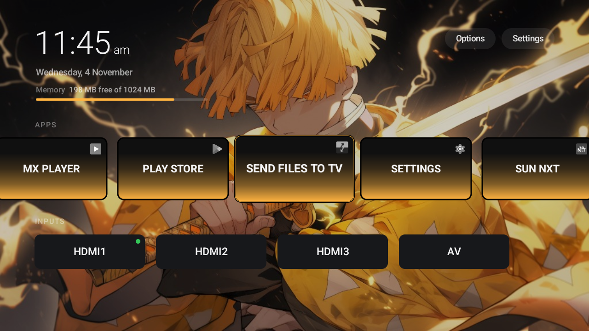

# 📺 TV UI Editor — Smart TV Minimalist Launcher & UI Optimization Suite

> **An ultra-clean, ad-free custom TV launcher and interface management suite for Android TV and Fire TV devices. Strips clutter, tracking, and bloat while delivering instant access to your favorite apps and HDMI inputs.**


---

## 📸 Interface Preview & Screenshots

<div align="center">

### 🖥️ Clean TV Home Dashboard
*Custom minimalist Leanback launcher displaying current clock, organized app grid, and direct HDMI input switching.*



<br/>

### 📊 System Status & Telemetry Dashboard
*Real-time hardware status, network diagnostics, and package management monitor.*


</div>

---

## 📌 Overview

Smart TVs and streaming sticks (such as Fire TV, Google TV, and Android TV) are increasingly cluttered with autoplay video advertisements, sponsored content, background telemetry, and slow OEM launcher bloatware.

**TV UI Editor** transforms your television back into a fast, private, distraction-free display. It replaces the default sponsored launcher with a streamlined, ultra-fast custom launcher that boots directly into your apps and HDMI inputs without ads, sponsored recommendations, or performance overhead.

---

## ✨ Key Capabilities & Modules

### 1. 🚀 Minimalist TV Launcher (`launcher/`)
- **Direct HDMI Switching:** Dedicated instant-switch buttons for HDMI 1, HDMI 2, and external gaming/console inputs.
- **Customizable App Matrix:** Add, hide, reorder, and categorize streaming apps with clean TV remote D-Pad navigation.
- **Ultra-Low Memory Footprint:** Consumes less than 35MB RAM, ensuring snappy responsiveness even on entry-level streaming sticks.
- **Ambient Clock & Status Bar:** Minimalist digital clock with date and Wi-Fi connection indicator.

### 2. 🛡️ Smart TV Debloat Engine (`scripts/debloat.sh`)
- Safely disables OEM promotional background services, sponsored recommendation daemons, and tracking trackers without breaking OS functionality.
- One-click restore scripts (`scripts/restore.sh`) to effortlessly revert any configuration back to factory settings.

### 3. 🌐 DNS & Privacy Filter (`scripts/dnsfilter.sh`)
- Enforces private DNS profiles blocking over 50,000+ known smart TV telemetry and advertising domains.
- Prevents remote analytics logging by TV manufacturers.

### 4. 🎮 Input & Accessibility Automation (`scripts/accessibility.sh`)
- Maps TV remote home buttons directly to the clean TV UI Editor launcher.
- Enables high-contrast focus rings for effortless remote control visibility in dark home-theater rooms.

---

## 🛠️ Project Architecture

```
tv-ui-editor/
├── launcher/                # Android Leanback custom launcher application
│   ├── AndroidManifest.xml  # TV launcher manifest & intent filters
│   ├── build.sh             # Native build script
│   ├── build_custom.ps1     # PowerShell build & deployment helper
│   ├── install.sh           # One-click ADB sideload script
│   ├── res/                 # Vector drawables, layouts, and TV focus styles
│   └── src/                 # Java / Android source code
├── scripts/                 # Automated ADB provisioning & debloat scripts
│   ├── debloat.sh           # Disables OEM ads and telemetry services
│   ├── dnsfilter.sh         # Privacy DNS profile installer
│   ├── configure.sh         # Custom launcher configuration manager
│   ├── launcher.sh          # Default launcher override daemon
│   └── restore.sh           # Factory reset and fallback recovery
├── docs/                    # Architectural documentation and assets
│   └── assets/              # Icons, banners, and vector assets
├── screen.png               # High-resolution home screen screenshot
├── tv_status.png            # Telemetry monitor screenshot
├── home.conf                # Launcher layout configuration file
├── LICENSE                  # MIT License
└── README.md                # System documentation
```

---

## 🚀 Installation & Quickstart

### Prerequisites
- Android TV / Google TV / Fire TV stick (Android 7.0+ / Fire OS 6+)
- Computer with `adb` (Android Debug Bridge) installed
- TV connected to the same Wi-Fi network with **Developer Options** and **ADB Debugging** enabled

---

### Step 1: Connect to your TV via ADB

Find your TV's IP address (Settings → Network) and connect:
```bash
adb connect <TV_IP_ADDRESS>:5555
```
*(Allow the USB/network debugging prompt on your TV screen).*

---

### Step 2: Sideload & Install the Custom Launcher

Run the automated launcher installation script:
```bash
# On Linux / macOS / Git Bash:
cd launcher
./install.sh

# On Windows (PowerShell):
.\build_custom.ps1
```

---

### Step 3: Run the Debloat & Privacy Optimizer

To remove sponsored ads and background tracking:
```bash
cd scripts
bash debloat.sh
bash dnsfilter.sh
```

Restart your TV. Your television will now boot immediately into the clean, distraction-free **TV UI Editor** home screen!

---

## 🔄 How to Uninstall / Restore Default Settings

If you ever want to revert back to the original manufacturer launcher:
```bash
cd scripts
bash restore.sh
```
All disabled system applications and OEM launchers will be restored immediately.

---

## 📄 License

This project is open-source and licensed under the **MIT License** — see the [LICENSE](LICENSE) file for full details.

```text
Copyright (c) 2026 Pradeep S (https://github.com/pradeep5250)
```

---

## 👤 Author & Maintainer

**Developed & Engineered by [Pradeep S](https://github.com/pradeep5250)**

- 🌐 **GitHub:** [@pradeep5250](https://github.com/pradeep5250)
- 💼 **LinkedIn:** [Pradeep S](https://www.linkedin.com/in/pradeep-s-550657314/)
- 📧 **Email:** [peedarp5250@gmail.com](mailto:peedarp5250@gmail.com)
